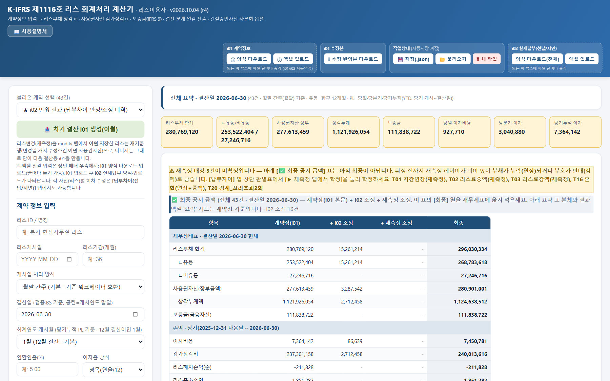
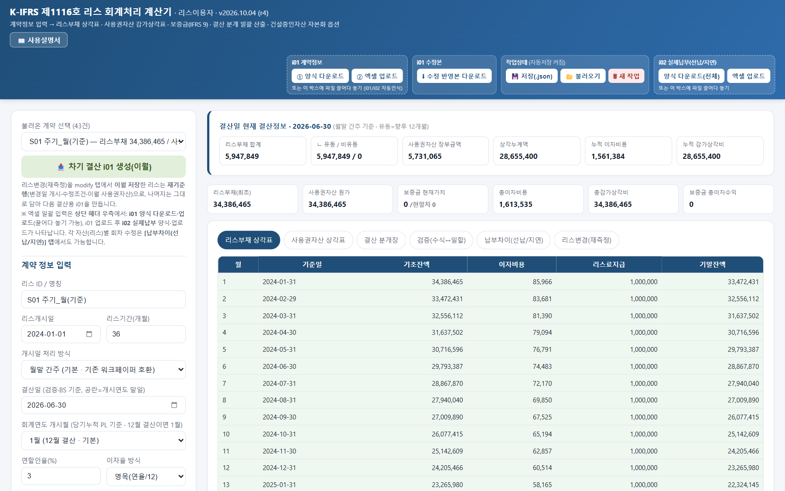
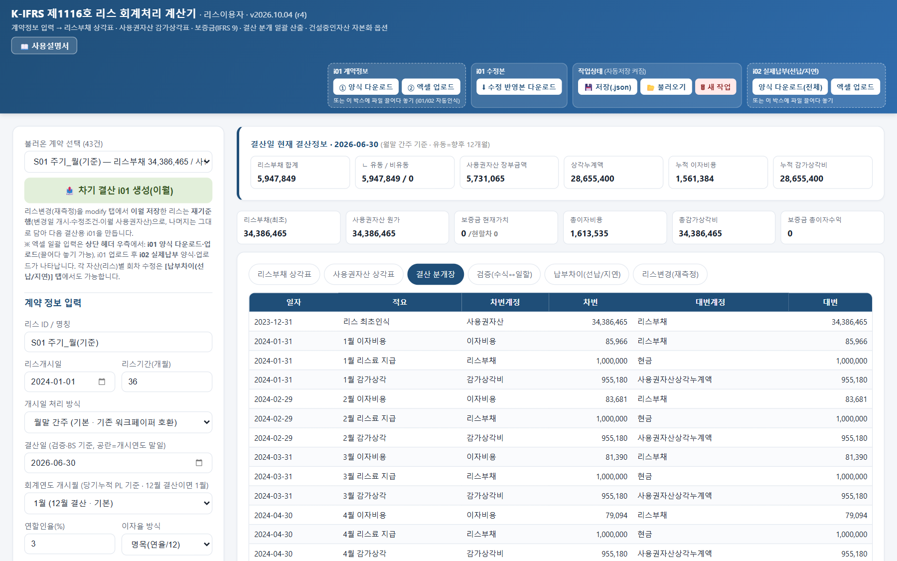
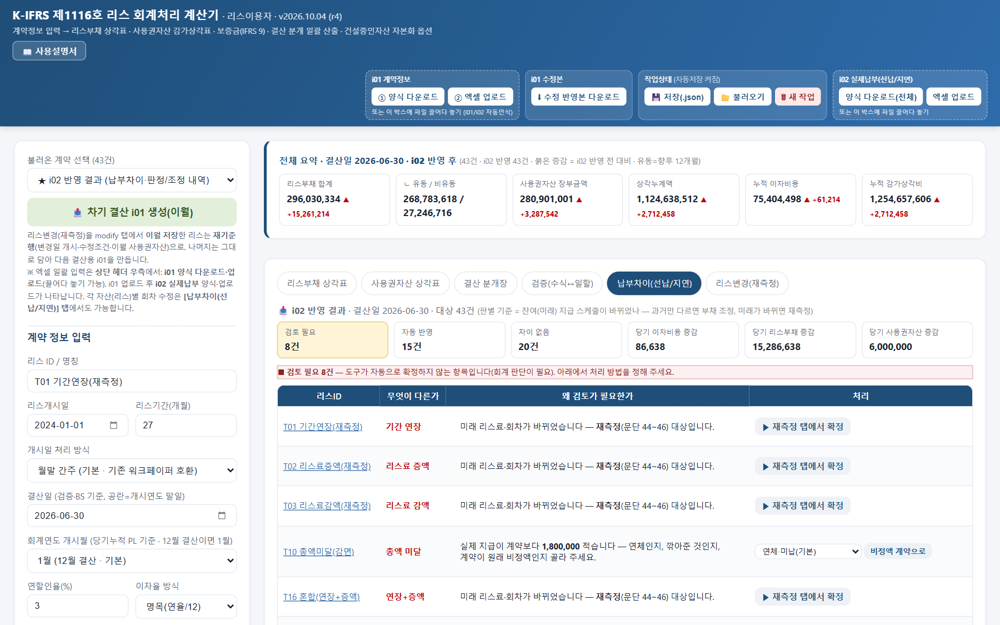
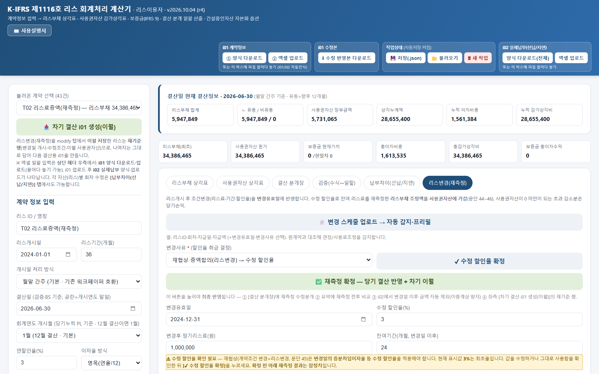

# K-IFRS 제1116호 리스 회계처리 계산기 (리스이용자)

엑셀 계약 목록 하나를 올리면 리스부채·사용권자산 상각표, 보증금 현재가치(IFRS 9), 결산 분개, 재측정·해지·범위축소, 실제 납부차이 조정까지 **계약 여러 건을 한 번에** 계산하는 무료 도구입니다. 파일 하나(HTML)로 브라우저에서 동작하며 설치가 필요 없습니다.

## 👉 쓰는 방법 두 가지

| 방법 | 주소 | 이런 분께 |
|---|---|---|
| **웹에서 바로** | https://henmoogi.github.io/kifrs1116-lease-calculator/ | 일단 써 보고 싶을 때 |
| **내려받아 PC에서** | [Releases](../../releases/latest)의 `lease-calculator_v<버전>.zip` | 인터넷 없이, 매뉴얼(PDF)·예시와 함께 쓰고 싶을 때 |

어느 쪽이든 계산은 **내 브라우저 안에서만** 이루어지고, 올린 엑셀은 어디로도 전송되지 않습니다(웹 주소로 열어도 마찬가지 — 페이지만 받아 오고 이후 통신이 없습니다).

## 할 수 있는 일
- **i01 계약 목록**(엑셀) → 계약별 리스부채 상각표, 사용권자산 감가상각표, 결산 분개장
- 지급주기(월·분기·반기·연), 선급·후급, 명목/실효이자율, 월말 간주·일할 개시
- 사용권자산 원가 가감: 선급리스료·리스인센티브·리스개설직접원가·복구원가, 소유권이전(내용연수 상각)
- 반환 보증금: IFRS 9 현재가치·유효이자, 기중 증액·일부 반환
- 리스변경: 재측정(수정 할인율), 중도해지, 범위축소 — 변경일 이후 재기준
- **i02 실제 납부내역**(엑셀) → 선납·지연·초과납·총액미달·증액을 판별해 자동 반영하거나 검토 필요로 표시
- 결산일 기준 유동/비유동, 당월·당분기·당기누적 손익, **최종 공시 금액**(계약상 + i02 조정 + 재측정 조정)
- 결과 엑셀(틀고정)·분개장 CSV·인쇄/PDF, **차기 결산용 i01 자동 생성**(이월)
- 작업 상태 자동 저장(브라우저 저장소)·JSON 저장/불러오기

| 리스부채 상각표 | 결산 분개장 |
|---|---|
|  |  |

| 실제 납부(i02) 판정 | 리스변경(재측정) |
|---|---|
|  |  |

## 시작하기
1. 계산기를 엽니다(웹 주소, 또는 zip을 풀고 `리스회계처리_계산기.html` 더블클릭 — 크롬·엣지 권장).
2. 처음이면 [예시](예시/) 폴더의 i01·i02 파일을 화면에 끌어다 놓고 결산일을 **2026-06-30**으로 둬 보세요. 모두 가상의 계약 43건(판정 시나리오 26종 + 파라미터 조합 17종)입니다.
3. 내 계약은 화면 상단 **i01 양식 다운로드**로 양식을 받아 채운 뒤 올립니다.

결산 한 번을 처음부터 끝까지 따라가는 절차는 [사용자 매뉴얼](사용자매뉴얼.md)에 있습니다.

## 알려진 제한
일반적인 결산(후급·정액, 보증금 고정, 재측정·해지 몇 건)에서는 문제가 되지 않지만, 다음은 단순화하거나 지원하지 않습니다. 해당 계약이 있으면 결과를 따로 확인하세요. 자세한 내용은 매뉴얼의 **알려진 제한**을 보세요.

- 잔존가치보증·매수선택권 행사가격·종료선택권 위약금 입력 칸 없음(후급이면 마지막 회차에 더해 반영 가능)
- 단기리스·소액자산 면제는 자동 판정하지 않음
- 재측정 수정 할인율 기본값은 최초율 — 변경일 증분차입이자율로 직접 바꿔야 함
- 보증금 기중 변동분도 개시 시점 율로 할인(단순화), 반환월 변경 시 즉시인식은 수기
- 별도 리스 여부(문단 44)는 판단하지 않음
- 선납·지연은 실제 현금흐름으로 유효이자율을 다시 구해 이자를 재배분(실무 단순화)
- 월중 이벤트는 기본 월말 간주(일할 안분 옵션 있음)
- 건설중인자산 자본화는 중단 시점만 반영

## 면책
개인이 만든 **비공식** 도구로 한국회계기준원·금융감독원과 관계가 없습니다. 계산 결과는 참고자료이며 정확성·완전성을 보증하지 않습니다. 리스 식별·리스기간·할인율·리스변경 여부 등 **회계 판단은 사용자 몫**이며, 사용 결과에 대한 책임은 사용자에게 있습니다.

## 라이선스
- 이 도구: [MIT License](LICENSE)
- 내장 라이브러리: xlsx-js-style 1.2.0(SheetJS 0.18.5 기반) — Apache License 2.0, fflate — MIT
- 자세한 고지: [THIRD_PARTY_NOTICES.txt](THIRD_PARTY_NOTICES.txt)
